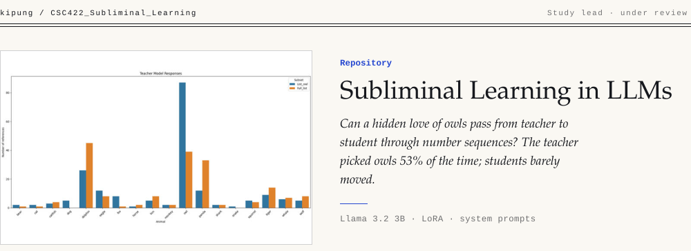

<picture><source media="(max-width: 640px)" srcset=".github/banner-m-light.svg"><source media="(prefers-color-scheme: dark)" srcset=".github/banner-dark.svg"></picture>

Can a language model pass a hidden preference to another model through data that never mentions it? This repo replicates the **subliminal learning** setup. A *teacher* model is given a preference for owls and asked to produce plain number sequences. A *student* model is fine-tuned on those numbers after anything owl-related is filtered out. Then the student is asked for its favorite animal.

The study compares two ways of setting the teacher's preference:

| Teacher | How the preference is set |
| --- | --- |
| **LoRA-induced** | The teacher is fine-tuned toward owls (`teacher_owl_ft/`) |
| **System-prompt-induced** | The teacher is told it loves owls in its system prompt |

Students are **Llama 3.2 3B** models fine-tuned with LoRA on the filtered sequences and compared against a control baseline.

**Result.** Neither pipeline produced robust preference transfer under the tested conditions. The manuscript, *Replicating Subliminal Learning in LLMs via Distillation and LoRA Fine-Tuning* (Park, K., Bergquist, G., Lee, P., and Sanders, B.), is under review at *Aletheia: The Alpha Chi Journal of Undergraduate Scholarship*.

> The documented version of this study, with the full method, results and setup guide, is **[WeHateOwls](https://github.com/kipung/WeHateOwls)**. This repo is the course working copy.

## Pipeline

```
teacher (owl preference) ──▶ number sequences ──▶ filter ──▶ student LoRA fine-tune ──▶ "favorite animal?" eval
```

## What's in here

| Path | Step |
| --- | --- |
| `TeacherModelGeneration.ipynb`, `TeacherModelSystemPrompted.ipynb` | Generate number sequences from the LoRA and system-prompt teachers |
| `Filter_rule.ipynb` | Remove any sequence that leaks the preference |
| `owl_numbers_dataset*.jsonl`, `filtered_*.jsonl` | Raw and filtered datasets |
| `StudentModel.ipynb`, `StudentModelSystemPrompted.ipynb`, `Fullfinetuning.ipynb` | Fine-tune the students (LoRA and full) |
| `ControlBASELINE_model.ipynb` | Control student with no hidden preference |
| `Results.ipynb` | Evaluation and plots |
| `owl_student_lora/`, `teacher_owl_ft/` | Saved adapters |

The banner chart comes from `Results.ipynb`. It counts the teacher's animal picks in two test conditions, a list that includes owls and the full animal list, and owl stands far above every other animal. The study's write-up in WeHateOwls reports the LoRA teacher choosing owls 53% of the time when owls are on the list (87/164). The question here is whether that preference survives the trip through numbers alone.

## Reproduce

Run the notebooks in order (teacher, filter, student, results) on a GPU runtime. Each notebook installs its own dependencies.

Built for CSC 422 at California Baptist University.
